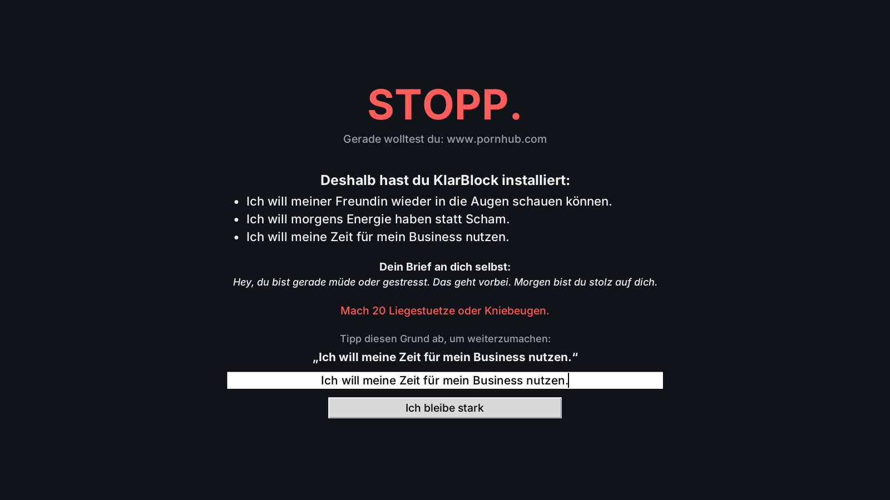

# KlarBlock

Kostenloser Selbsthilfe-Blocker gegen Pornografie für Windows 10/11.



## Was es macht

- **Sperrt rund 76.000 Pornoseiten** systemweit über die Windows-Hosts-Datei. Gilt für jeden Browser, auch im Inkognito-Modus.
- **Nerv-Popup**: Wer eine gesperrte Seite aufruft, bekommt ein Vollbild-Fenster mit den eigenen Gründen. Es geht erst nach 30 Sekunden weg, und nur wenn man einen der Gründe Wort für Wort abtippt (Einfügen ist gesperrt).
- **Tor und Umgehungs-Tools**: Download-Seiten von Tor, Psiphon, Lantern, Ultrasurf und bekannten Web-Proxys sind gesperrt. Läuft trotzdem `tor.exe` o. ä., wird es beendet. Installer dieser Tools im Download-Ordner werden gelöscht.
- **Kein Schlupfloch über „Sicheres DNS“**: DNS-over-HTTPS wird in Chrome, Edge, Brave und Firefox per Richtlinie abgeschaltet, Brave-Tor-Fenster ebenfalls.
- **Selbstschutz**: Wird die Hosts-Datei verändert, stellt KlarBlock sie wieder her. Wird der Prozess beendet, startet ihn die Aufgabenplanung nach spätestens 5 Minuten neu.
- **Deaktivieren nur mit Wartezeit** (Standard 24 Stunden, bis 7 Tage einstellbar) und erneutem Abtippen eines Grundes. Bewusst schwer, aber nicht unmöglich: es ist ein Werkzeug für freiwillige Selbstkontrolle, keine Kindersicherung.

## Installation (für Nutzer)

1. `KlarBlock.exe` herunterladen.
2. Doppelklick, Windows fragt nach Administratorrechten: „Ja“.
3. Mindestens drei Gründe aufschreiben, optional einen Brief an dein zukünftiges Ich, Wartezeit wählen.
4. „Blocker aktivieren“. Fertig.

Erneuter Doppelklick auf `KlarBlock.exe` öffnet das Statusfenster (Tage, Versuche heute, Deaktivierung anfordern, Blockliste aktualisieren).

## Deinstallieren

**Normaler Weg:** `KlarBlock.exe` erneut starten, „Deaktivierung anfordern“, Wartezeit abwarten, „Jetzt deaktivieren“.

**Wichtig:** Einfach die `.exe` zu löschen entfernt KlarBlock **nicht**. Der Blocker läuft aus `C:\Program Files\KlarBlock\` weiter, und die Einträge in der Hosts-Datei bleiben.

**Notfall-Entfernung (ohne Wartezeit):** `notfall-entfernen.bat` mit Rechtsklick > „Als Administrator ausführen“ starten. Das Skript beendet den Hintergrundprozess, löscht die geplanten Aufgaben, entfernt den KlarBlock-Block aus der Hosts-Datei, setzt die Browser-Richtlinien zurück und löscht Programm- und Einstellungsordner. Danach den Browser neu starten. Gedacht zum Testen und für defekte Installationen.

**Von Hand**, falls das Skript nicht geht (Eingabeaufforderung als Administrator):

```
schtasks /delete /f /tn KlarBlock
schtasks /delete /f /tn KlarBlock-Waechter
taskkill /f /im KlarBlock.exe
notepad C:\Windows\System32\drivers\etc\hosts
```

Im Editor alles von `# >>> KlarBlock BEGIN` bis `# <<< KlarBlock END <<<` löschen und speichern. Zum Schluss `ipconfig /flushdns`.

## Bauen (für dich als Entwickler)

Auf einem Windows-PC mit Python 3.11+ von python.org: `build.bat` ausführen. Ergebnis: `dist\KlarBlock.exe`.

Ohne Bauen testen: `python klarblock.py` in einer Administrator-Eingabeaufforderung.

Tests (laufen auch unter Linux/macOS): `python -m pytest test_klarblock.py`

## Wie es technisch funktioniert

| Teil | Umsetzung |
|---|---|
| Sperre | Einträge `127.0.0.1 domain …` (9 pro Zeile, damit Windows schnell bleibt) zwischen Markern in `C:\Windows\System32\drivers\etc\hosts` |
| Erkennen von Aufrufen | Hintergrundprozess lauscht auf `127.0.0.1:80` und `:443`, liest bei HTTPS den Servernamen (SNI) aus dem Verbindungsaufbau, bei HTTP den Host-Header |
| Popup | tkinter-Vollbildfenster, immer im Vordergrund, 30 s Countdown, Abtippen erforderlich |
| Autostart | Zwei Aufgaben in der Aufgabenplanung: „KlarBlock“ (bei Anmeldung) und „KlarBlock-Waechter“ (alle 5 Minuten) |
| Daten | `C:\ProgramData\KlarBlock\` (config.json, blocklist.txt, versuche.log) |

## Grenzen (ehrlich gesagt)

- Wer Administratorrechte hat und es wirklich will, kann KlarBlock aushebeln (Prozess beenden + Hosts-Datei leeren + Aufgaben löschen). Das Ziel ist, den Impuls lange genug zu unterbrechen, nicht eine Festung.
- Bilder auf „normalen“ Seiten (Reddit, X, Suchmaschinen-Bildersuche) werden nicht gefiltert. Tipp für die Anleitung: SafeSearch erzwingen und zusätzlich einen Familien-DNS wie CleanBrowsing oder NextDNS eintragen.
- Kommerzielle VPN-Apps werden nicht generell gesperrt, weil viele Menschen sie beruflich brauchen.
- Handy und Tablet sind nicht abgedeckt.

## Lizenzen

- Blockliste: [StevenBlack/hosts](https://github.com/StevenBlack/hosts), Erweiterung „porn“, MIT-Lizenz. Bei Weitergabe den Lizenzhinweis von StevenBlack beilegen bzw. verlinken.
- KlarBlock selbst: MIT-Lizenz (siehe LICENSE).
